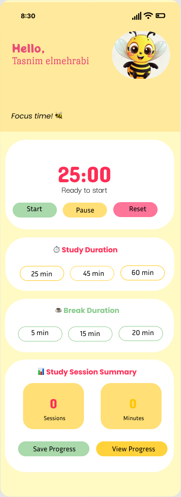
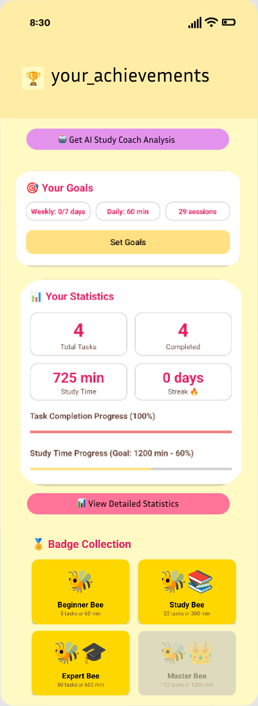
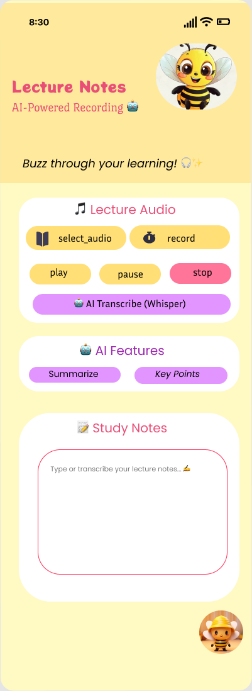

<div align="center">

# Study with Bee

Android application for students: task management, Pomodoro study sessions, and progress tracking with goals and badges.


<br>






</div>

---

## Table of contents

- [Features](#features)
- [Tech stack](#tech-stack)
- [Project structure](#project-structure)
- [Getting started](#getting-started)
- [Design](#design)
- [Roadmap](#roadmap)
- [License](#license)
- [Author](#author)

## Features

| Feature | Description |
|---|---|
| Tasks | Create, edit and delete tasks with a due date and a priority (high, medium, low). Completed and pending lists, weekly calendar view, color-coded priority badges. |
| Study timer | Sessions of 25, 45 or 60 minutes with start, pause and reset. Notification at the end of a session, automatic progress saving, total study time. |
| Goals | Weekly goal (days), daily goal (minutes) and total study time target, with progress bars and automatic goal detection. |
| Achievements | Four badges unlocked by completed tasks or study time. |
| Statistics | Completion rate, total study time, study streak and session history. |
| Lecture notes | Create notes, organize them by subject, search them. |
| Reminders | Custom task reminders, local notifications for upcoming deadlines, daily study reminders. |
| Accounts | Registration, login and user profile. |

### Achievement badges

| Badge | Requirement |
|---|---|
| Beginner Bee | 5 tasks completed or 60 minutes studied |
| Study Bee | 20 tasks completed or 300 minutes studied |
| Expert Bee | 50 tasks completed or 600 minutes studied |
| Master Bee | 100 tasks completed or 1200 minutes studied |

## Tech stack

| Area | Technologies |
|---|---|
| Language | Java |
| Platform | Android SDK, min API 21 |
| Build | Gradle |
| UI | Material Components, CardView, RecyclerView, ConstraintLayout, CalendarView |
| Storage | SharedPreferences, file storage with JSON serialization |
| Other | CountDownTimer, Android notifications |

The code follows a simple MVC structure: `model` and `controller` packages for tasks, and one activity per screen (11 screens).

## Project structure

```
study-with-bee/
├── app/
│   └── src/main/
│       ├── AndroidManifest.xml
│       ├── java/com/example/myapplication/
│       │   ├── controller/TaskController.java
│       │   ├── model/Task.java
│       │   ├── SplashActivity.java
│       │   ├── LoginActivity.java / RegisterActivity.java
│       │   ├── MainActivity.java
│       │   ├── ToDoListActivity.java / AddTaskActivity.java / ViewTasksActivity.java
│       │   ├── StudyTimerActivity.java
│       │   ├── AchievementsActivity.java
│       │   ├── LectureNotesActivity.java
│       │   └── RemindersActivity.java
│       └── res/   # layouts, drawables, colors, strings, themes
├── docs/          # screenshots used in this README
└── gradle/
```

## Getting started

Requirements: Android Studio Arctic Fox (2020.3.1) or newer, JDK 8 or higher, Android SDK API 21+.

```bash
git clone https://github.com/tass027/study-with-bee.git
```

1. Open the `study-with-bee` folder in Android Studio.
2. Wait for the Gradle sync to finish.
3. Start an emulator (API 21+) or connect a device, then click Run.

## Design

The interface is based on the Figma Community file "StudyMate mobile app design", adapted for this project.
<!-- TO COMPLETE: add the author's name and the link to the ORIGINAL Community page (not your private copy), e.g. "by AUTHOR ([source](LINK))" -->

## Roadmap

- Dark mode
- Cloud synchronization with Firebase
- Statistics with charts
- Home screen widget
- Data export (CSV, PDF)
- Multi-language support (French, Arabic)

## License

Distributed under the MIT License. See the [LICENSE](LICENSE) file.

## Author

Tasnim Elmehrabi - [GitHub](https://github.com/tass027) - [LinkedIn](https://www.linkedin.com/in/VOTRE-PROFIL)
