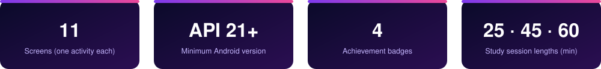
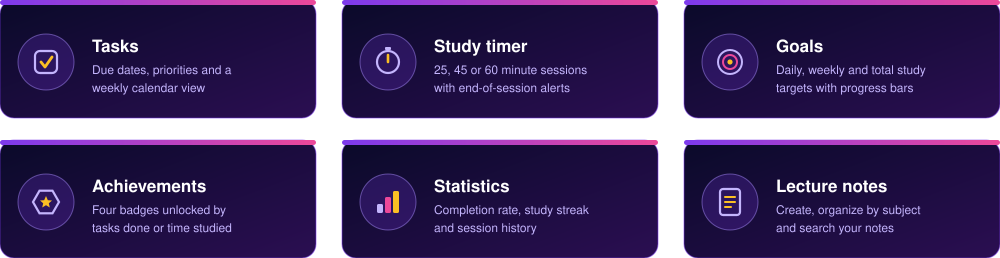
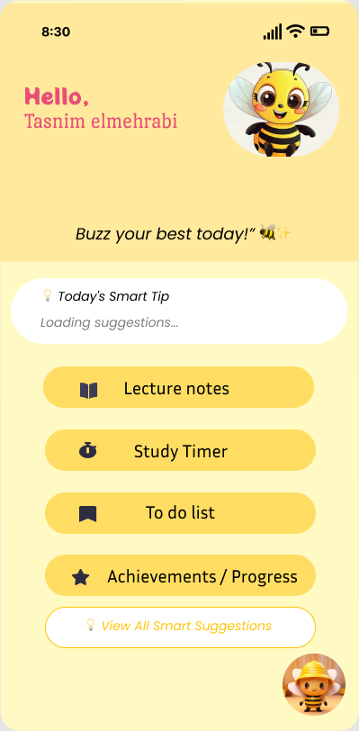
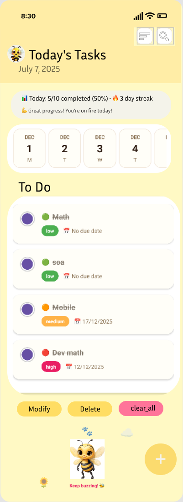
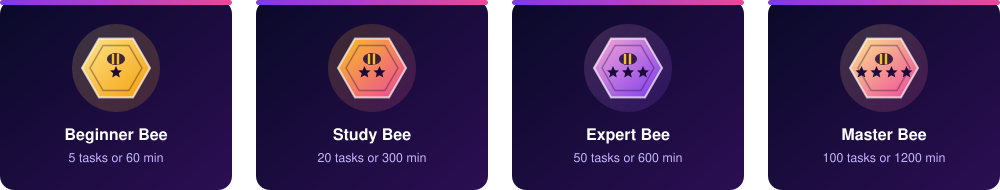
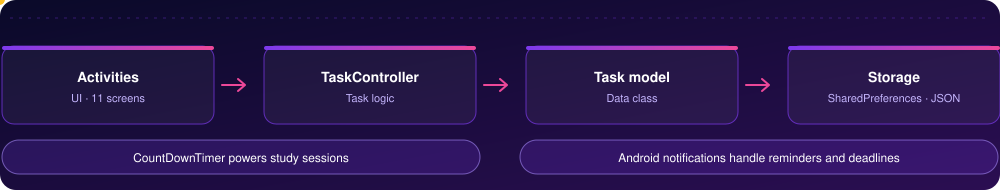

<div align="center">



<br>


**Manage tasks, focus with Pomodoro sessions and track your progress, all in one Android app.**

[Overview](#overview) · [Features](#features) · [Screenshots](#screenshots) · [Achievements](#achievements) · [How it works](#how-it-works) · [Getting started](#getting-started) · [Roadmap](#roadmap) · [Author](#author)

</div>

---

## Overview

Study with Bee helps students organize their work and stay consistent. Tasks, study sessions, goals and lecture notes live in a single app, and progress is rewarded with badges.

**Problem.** Students juggle deadlines, notes and study time across several tools, which makes it hard to stay consistent.

**Solution.** One simple Android app that combines a task manager, a study timer, goal tracking and notes, with reminders and achievements to keep motivation up.

<div align="center">



</div>

## Features

<div align="center">



</div>

| Feature | Description |
|---|---|
| Tasks | Create, edit and delete tasks with a due date and a priority (high, medium, low). Completed and pending lists, weekly calendar view, color-coded priority badges. |
| Study timer | Sessions of 25, 45 or 60 minutes with start, pause and reset. Notification at the end of a session, automatic progress saving, total study time. |
| Goals | Weekly goal (days), daily goal (minutes) and total study time target, with progress bars and automatic goal detection. |
| Achievements | Four badges unlocked by completed tasks or study time. |
| Statistics | Completion rate, total study time, study streak and session history. |
| Lecture notes | Create notes, organize them by subject, search them. |
| Reminders | Custom task reminders, local notifications for upcoming deadlines, daily study reminders. |
| Accounts | Registration, login and user profile. |

## Screenshots

<div align="center">





</div>

## Achievements

<div align="center">



</div>

| Badge | Requirement |
|---|---|
| Beginner Bee | 5 tasks completed or 60 minutes studied |
| Study Bee | 20 tasks completed or 300 minutes studied |
| Expert Bee | 50 tasks completed or 600 minutes studied |
| Master Bee | 100 tasks completed or 1200 minutes studied |

## How it works

<div align="center">



</div>

1. Each screen is an **Activity** (11 in total) that handles the user interface.
2. **TaskController** applies the task logic: create, update, delete, filter.
3. The **Task** model holds the task data (title, due date, priority, status).
4. Data is stored locally with **SharedPreferences** and JSON files.
5. **CountDownTimer** runs the study sessions and **Android notifications** deliver reminders.

### Tech stack

| Area | Technologies |
|---|---|
| Language | Java |
| Platform | Android SDK, min API 21 |
| Build | Gradle |
| UI | Material Components, CardView, RecyclerView, ConstraintLayout, CalendarView |
| Storage | SharedPreferences, file storage with JSON serialization |
| Other | CountDownTimer, Android notifications |

The code follows a simple MVC structure: `model` and `controller` packages for tasks, and one activity per screen.

## Getting started

**Prerequisites**

- Android Studio Arctic Fox (2020.3.1) or newer
- JDK 8 or higher
- Android SDK API 21+

```bash
# Clone the repository
git clone https://github.com/tass027/study-with-bee.git
```

1. Open the `study-with-bee` folder in Android Studio.
2. Wait for the Gradle sync to finish.
3. Start an emulator (API 21+) or connect a device, then click **Run**.

## Project structure

```
study-with-bee/
├── app/
│   └── src/main/
│       ├── AndroidManifest.xml
│       ├── java/com/example/myapplication/
│       │   ├── controller/TaskController.java
│       │   ├── model/Task.java
│       │   ├── SplashActivity.java
│       │   ├── LoginActivity.java / RegisterActivity.java
│       │   ├── MainActivity.java
│       │   ├── ToDoListActivity.java / AddTaskActivity.java / ViewTasksActivity.java
│       │   ├── StudyTimerActivity.java
│       │   ├── AchievementsActivity.java
│       │   ├── LectureNotesActivity.java
│       │   └── RemindersActivity.java
│       └── res/               # layouts, drawables, colors, strings, themes
├── assets/                    # README graphics
├── docs/                      # app screenshots
└── gradle/
```

## Design

The interface is based on the Figma Community file "StudyMate mobile app design", adapted for this project.
<!-- TO COMPLETE: add the author's name and the link to the ORIGINAL Community page (not your private copy), e.g. "by AUTHOR ([source](LINK))" -->

## Roadmap

- [ ] Dark mode
- [ ] Cloud synchronization with Firebase
- [ ] Statistics with charts
- [ ] Home screen widget
- [ ] Data export (CSV, PDF)
- [ ] Multi-language support (French, Arabic)

## Contributing

1. Fork the repository.
2. Create a feature branch: `git checkout -b feature/your-feature`
3. Commit your changes: `git commit -m "Add your feature"`
4. Push the branch: `git push origin feature/your-feature`
5. Open a Pull Request.

## License

Distributed under the MIT License. See the [LICENSE](LICENSE) file.

## Author

**Tasnim Elmehrabi** · [GitHub](https://github.com/tass027) · [LinkedIn](https://www.linkedin.com/in/VOTRE-PROFIL)
